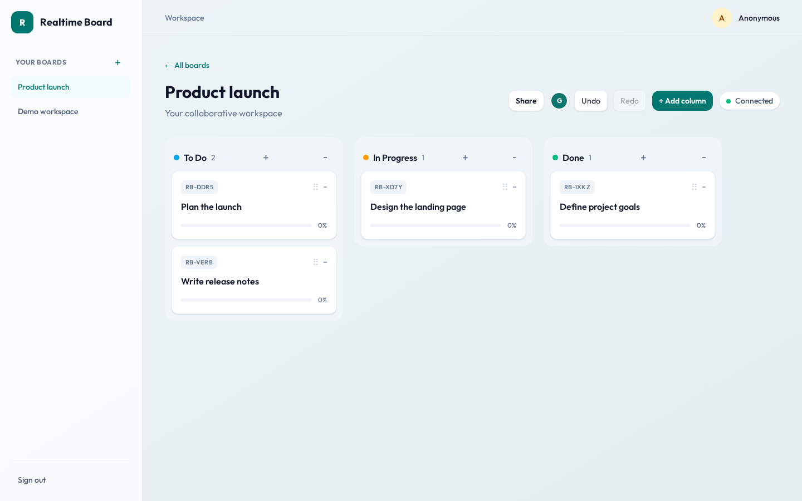
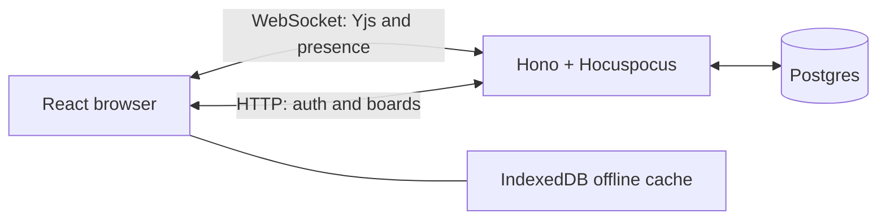

# Realtime Board

A collaborative kanban board built with React, Hono, Postgres, Yjs, and Hocuspocus. Move cards with your team, see who's online, and keep working through a lost connection.



[Watch a short collaboration demo](docs/collaboration.webm)

## Try it locally

Follow the setup below, select **Try demo**, and open the demo workspace in two separate browser sessions. Add or move a card in one window and watch it appear in the other. Move your cursor to see live presence, or disconnect one session and reconnect it after making an edit.

The demo workspace is shared by anonymous users and resets periodically. Avoid putting private information in it.

## Highlights

- Real-time cards, columns, presence, and cursors across browser sessions.
- Invitations with editor or viewer permissions, enforced on the server.
- Offline edits stored in IndexedDB and synchronized after reconnecting.
- Local undo and redo, drag-and-drop ordering, due dates, and assignees.
- Guest access and optional GitHub sign-in.

## Design decisions

Concurrent card moves are a tricky case: deleting a card from one list and inserting it into another can create duplicates when people move it at the same time. Each card instead has a stable identity, a column ID, and an order key in a Yjs document. Yjs merges concurrent changes, while fractional order keys allow cards to be reordered without renumbering the entire column.



Board content is stored as Yjs snapshots; memberships and invitations are stored in relational tables. This favors collaborative editing, with trade-offs described below.

## Local development

Requirements: Node.js 24 or newer, pnpm 11.1.2, and Docker Compose.

```sh
cp .env.example .env
docker compose up -d
pnpm install
pnpm db:push
pnpm dev
```

Open <http://localhost:5173>. Choose **Try demo** to enter the shared demo workspace, or configure GitHub OAuth and use **Continue with GitHub**. The OAuth callback URL for local development is `http://localhost:3000/api/auth/callback/github`; use a separate GitHub OAuth app for production and set its production callback URL to `https://YOUR_APP_DOMAIN/api/auth/callback/github`.

Set `GITHUB_CLIENT_ID` and `GITHUB_CLIENT_SECRET` in `.env`. Set a private random `BETTER_AUTH_SECRET` before exposing the server. `.env` is ignored by Git.

## Checks

```sh
pnpm lint
pnpm typecheck
pnpm build
pnpm test
pnpm test:e2e
```

The Vitest suite includes board model and API integration coverage against the Compose Postgres database. Playwright runs Chromium and opens two independent browser contexts against the local dev server. Install its browser with `pnpm exec playwright install chromium` when needed.

## Architecture

- Vite serves the React app during development and proxies `/api` and `/sync` to the Hono server. The production Hono process serves the built SPA, REST API, and Hocuspocus WebSocket from one origin so Better Auth cookies work for both HTTP and WebSocket authentication.
- Better Auth stores users and sessions in Postgres. GitHub OAuth and anonymous guest sessions are enabled. An anonymous session sees the shared demo board; its content resets daily when no clients are connected.
- Board columns and cards are Yjs maps. Cards use random short codes and fractional order keys, allowing concurrent moves without deleting and reinserting card identities. Hocuspocus stores document snapshots as Postgres `bytea` after a short debounce.
- Board content is cached in the single Hocuspocus process. The Fly configuration keeps one machine running. Horizontal scaling needs a shared Hocuspocus/Redis extension so document updates and awareness reach every machine. Snapshot persistence is debounced, so a process crash can lose the latest couple of seconds of edits.
- Presence and cursors use Yjs awareness and are not persisted. Undo and redo apply to local changes. `y-indexeddb` preserves edits in the browser across disconnections and reloads.

## Deploying

The repository includes a Dockerfile and Fly.io configuration; nothing is deployed by this project. Create a Fly app and a Postgres database, set `DATABASE_URL`, `BETTER_AUTH_SECRET`, `BETTER_AUTH_URL`, `GITHUB_CLIENT_ID`, and `GITHUB_CLIENT_SECRET` as Fly secrets, then apply the schema and deploy using the Fly CLI. Keep exactly one machine running until shared Hocuspocus state is configured. Fly and Postgres accounts may incur charges.
